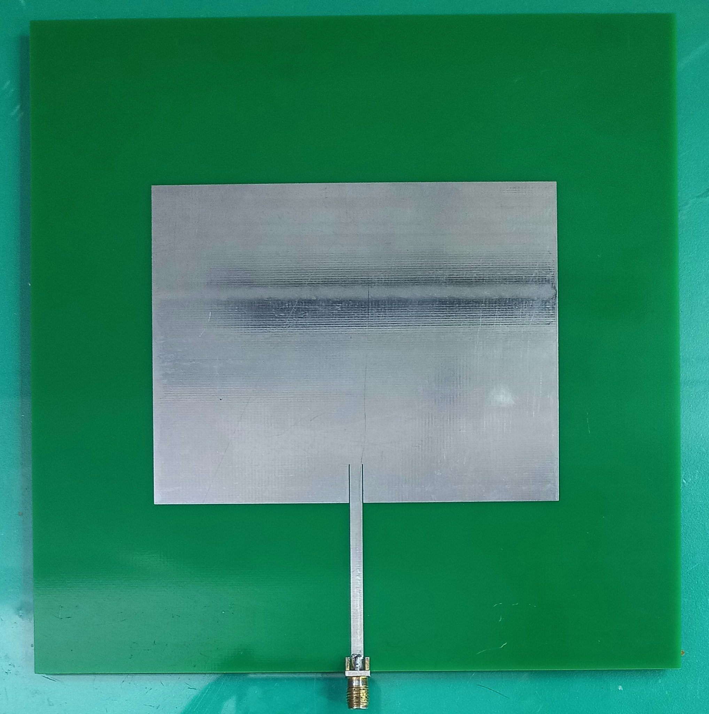
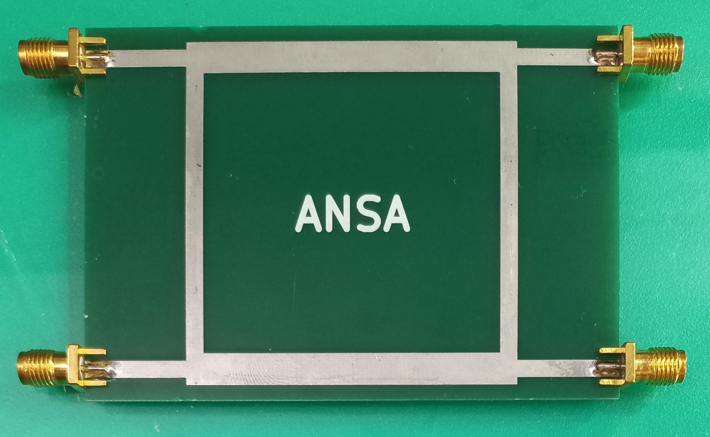
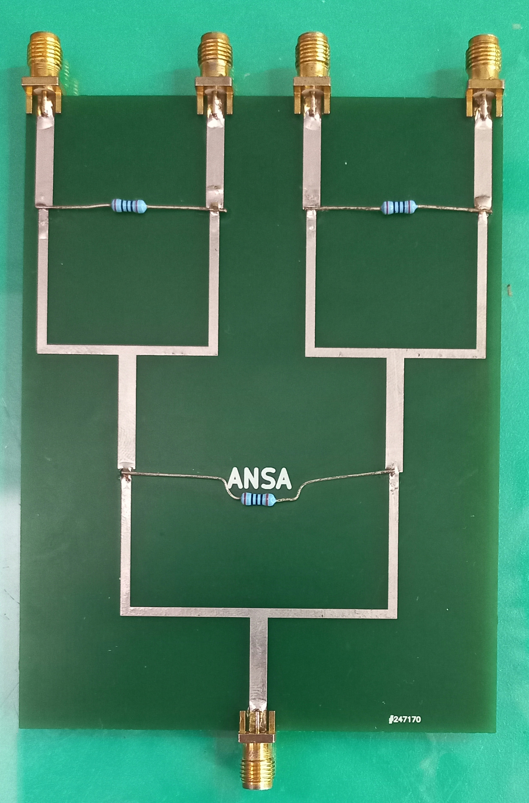
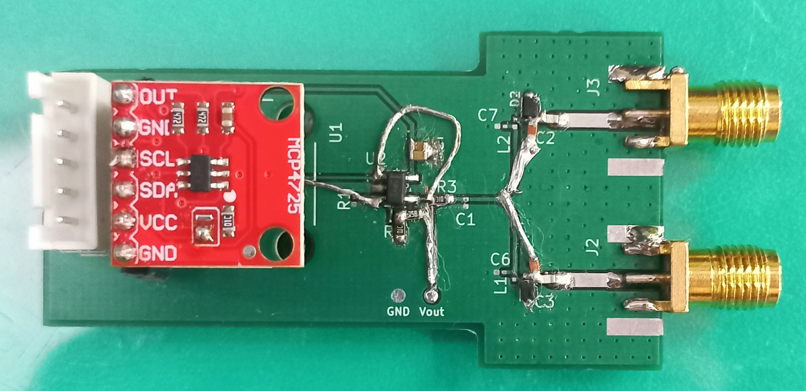
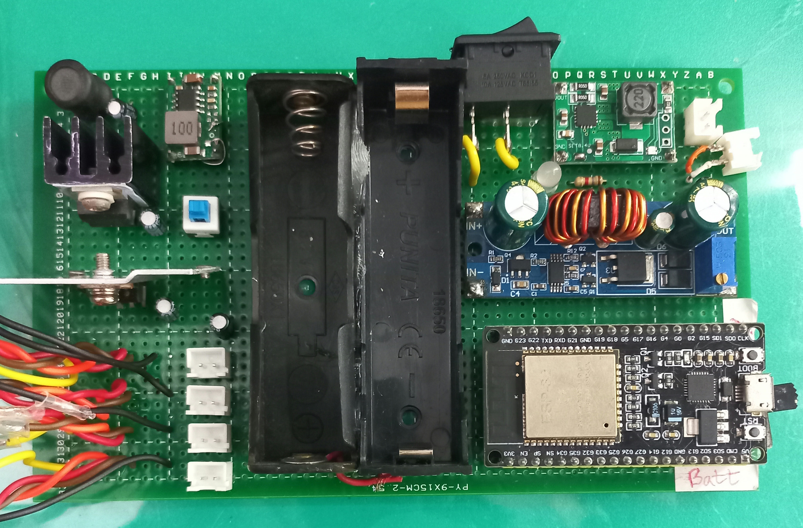

# ANSA — Adaptive Null-Steering Antenna System

> **Project stage:** Prototype fabrication and initial RF characterization  
> **Target frequency used in the reported experiments:** 815 MHz  
> **Current evidence:** Antenna and passive RF component measurements, plus an initial over-the-air reception test

ANSA (Adaptive Null-Steering Antenna System) is a hardware research project focused on developing an antenna and RF signal-processing platform for interference suppression. The current prototype work covers a microstrip patch antenna, a 90° hybrid branch-line coupler, an RF power combiner, a DC-bias/phase-control board, and a controller/power-distribution board.

This repository records the prototype hardware and the experimental results available at the current stage. The results below are component-characterization and signal-detection results; **adaptive null-steering performance has not yet been quantitatively demonstrated**.

## 1. Project objectives

- Design, simulate, fabricate, and characterize the antenna and RF network components.
- Establish a repeatable measurement baseline around the intended 815 MHz operating point.
- Integrate the RF components with the receiver and control hardware.
- Progress toward array-level evaluation of phase/amplitude control and interference suppression.
- Document measurements and limitations transparently so that later results can be reproduced and compared.

## 2. Hardware components

### 2.1 Microstrip patch antenna

The fabricated microstrip patch antenna receives the incident RF signal and feeds it into the downstream receive chain. Its impedance match is an important first check before evaluating the complete system.

**Reported measurement:** The antenna was measured with a vector network analyzer (VNA) over 727–927 MHz. At 815 MHz, the measured reflection coefficient was **S11 = −12.61 dB**, corresponding to approximately **5.5% reflected power**.

**Interpretation and remaining work:** This indicates a reasonable input match at the 815 MHz marker. The exact resonant frequency and impedance bandwidth have not yet been determined from the complete measured response. The full VNA trace should be retained and used to identify the resonance and −10 dB bandwidth, if applicable. Gain and radiation-pattern claims require separate measurements.

### 2.2 90° hybrid branch-line coupler

The four-port hybrid branch-line coupler is intended to establish a defined phase relationship between its output paths. For an ideal quadrature hybrid at its design frequency, the relevant output signals have approximately equal magnitudes and a 90° phase difference. Actual division, isolation, and phase balance must be established from measured S-parameters.

**Reported measurements, with DC bias connected:**

- Input impedance: approximately **49 Ω**.
- Input reflection coefficient: approximately **S11 = −29 dB**.
- Through transmission: **S21 ≈ −0.5 dB** over the reported 800–900 MHz range.
- Phase difference between S21 and S31: **84.6°**, which is **5.4°** away from the ideal 90° quadrature relationship.

The reported S11 corresponds to approximately **0.126% reflected power**, assuming the reported measurement and reference conditions are valid. These values are encouraging preliminary evidence for input matching and phase behaviour. They do not, by themselves, establish the complete power-division performance. The coupled-port transmission magnitude, output amplitude balance, isolated-port response, and full frequency-dependent S-parameters still need to be verified.

### 2.3 RF power combiner

The RF power combiner brings signals from the configured RF paths together at the designated output. Its measured behaviour depends on the port configuration and the relative phase and amplitude of the input signals. The precise topology and port roles should be documented alongside the circuit schematic.

**Reported forward-transmission measurements:**

- **S21 = −10.25 dB at 804.677 MHz.**
- **S21 = −9.56 dB at 948.587 MHz.**

These measurements provide preliminary transmission data for the measured port configuration. Neither marker is at 815 MHz, so they do not establish the combiner's transmission at the target frequency. A direct measurement at 815 MHz is required. Input matching, isolation, and the response across the intended band also remain to be established.

### 2.4 DC-bias / phase-control PCB

The photographed board includes two SMA connectors and an MCP4725 DAC breakout. The MCP4725 can generate a programmable analogue voltage from digital commands over I²C. The intended role of the remaining circuit is to provide a control/bias interface for the RF path; the exact tunable element and circuit behaviour should be confirmed from the schematic and bill of materials.

No measured phase-shift range, insertion-loss-versus-control sweep, or bias-to-phase calibration data is included in the results below. To establish its role in adaptive operation, measure RF transmission phase and magnitude at the target frequency for each DAC setting, record the control-voltage range, and check repeatability. Verify DC isolation before connecting the board to RF test equipment.

### 2.5 Controller and power-distribution board

The assembled board appears to include an ESP32 development board, a battery holder, a power switch, a DC–DC converter module, and wiring/connectors. It is intended to support control and power distribution for the prototype. A photograph alone does not establish that closed-loop adaptation is implemented or operational.

The repository should be extended with the power tree, rail voltages, connector pinout, current consumption, firmware functions, and the interface used to command the bias-control board. Closed-loop operation should only be claimed after the controller receives a defined measurement or feedback metric and updates the RF control settings accordingly.

## 3. Results and analysis

The experimental evaluation was initiated through fabrication and characterization of the primary RF components and an initial end-to-end reception test.

### 3.1 Antenna characterization

The patch antenna was measured using a VNA over **727–927 MHz**. At **815 MHz**, the measured **S11 was −12.61 dB**. This corresponds to approximately **5.5% of incident power reflected** at the antenna input. The result indicates a reasonable match at the selected marker frequency. The exact resonant frequency and impedance bandwidth remain to be determined from the complete measured response.

### 3.2 Hybrid-coupler characterization

With DC bias connected, the hybrid coupler's reported input impedance was approximately **49 Ω**, and its measured **S11 was approximately −29 dB**. The reported **S21 was approximately −0.5 dB across 800–900 MHz**. The measured phase difference between **S21 and S31 was 84.6°**, a deviation of **5.4°** from the ideal 90° quadrature relationship. The coupled-port transmission magnitude and isolation response still need to be verified before the power-division performance can be fully assessed.

### 3.3 Power-combiner characterization

The combiner's measured forward transmission coefficient **S21** was **−10.25 dB at 804.677 MHz** and **−9.56 dB at 948.587 MHz**. These are preliminary results for the measured port configuration. Since neither marker is at 815 MHz, the combiner's response at the target frequency remains unknown from these data. The input matching and isolation characteristics also remain to be established.

### 3.4 Initial over-the-air reception test

An initial reception experiment placed an RF transmitter approximately **6–7 m** from the receiving system. The received signal passed through the patch antenna, low-noise amplifier (LNA), branch coupler, and power combiner before reaching a spectrum analyzer. At **815 MHz**, the analyzer displayed a received signal level of **−44.6 dBm**.

This confirms detection of the transmitted signal through the assembled receive chain under the test conditions. It does **not** independently determine the gain or loss of any one component or the overall receive-chain gain. Interpretation also depends on transmitter output power, LNA gain, antenna characteristics, propagation conditions, cable and connector losses, and measurement setup.

### 3.5 Overall interpretation

The current experiments establish an initial hardware-characterization baseline. The antenna's input match, the coupler's reported phase relationship, two combiner transmission markers, and reception of an over-the-air signal have been documented. The evidence does not yet quantify adaptive null depth, interference suppression, array-level behaviour, or preservation of a desired signal in the presence of interference. Those claims require controlled, repeatable tests of the integrated multi-element system.

## 4. Performance metrics

**Table 1. Summary of reported experimental performance metrics**

| Component / test | Performance metric | Reported value |
|---|---|---:|
| Microstrip patch antenna | S11 at 815 MHz | −12.61 dB |
| Microstrip patch antenna | Reflected power fraction at 815 MHz | Approximately 5.5% |
| 90° hybrid branch-line coupler | Input impedance | Approximately 49 Ω |
| 90° hybrid branch-line coupler | S11 | Approximately −29 dB |
| 90° hybrid branch-line coupler | S21, with DC bias connected | Approximately −0.5 dB over 800–900 MHz |
| 90° hybrid branch-line coupler | S21-to-S31 phase difference | 84.6° |
| 90° hybrid branch-line coupler | Deviation from ideal 90° | 5.4° |
| RF power combiner | S21 at 804.677 MHz | −10.25 dB |
| RF power combiner | S21 at 948.587 MHz | −9.56 dB |
| Complete receive chain | Received level at 815 MHz | −19.4 dBm |
| Complete receive chain | Transmitter–receiver separation | Approximately 6–7 m |

The antenna's S11 corresponds to approximately 5.5% reflected power at 815 MHz. The coupler's S11 of −29 dB corresponds to approximately 0.126% reflected power under the reported conditions. Its 84.6° phase difference is 5.4° away from the ideal quadrature target. The combiner's recorded values indicate attenuation between the measured ports at the two marker frequencies, but its performance at 815 MHz must be measured directly. The −44.6 dBm reception level is a system-level observation and is not, on its own, a measure of gain, efficiency, or insertion loss.

## 5. Further validation required

| Subsystem | Next validation step | Evidence to retain |
|---|---|---|
| Patch antenna | Identify resonance and impedance bandwidth from the complete 727–927 MHz VNA trace; characterize radiation behaviour when equipment is available | Raw VNA trace, plot, substrate and geometry details, test setup |
| Hybrid coupler | Verify coupled-port magnitude, isolation, output balance, and phase difference across frequency | Full S-parameter data, port map, calibration details, plots |
| Power combiner | Measure S21 directly at 815 MHz and characterize input matching and isolation | Full frequency sweep, port configuration, schematic and plots |
| Bias/phase-control PCB | Measure phase and insertion loss versus DAC setting at the target frequency | Schematic, voltage range, sweep data, firmware version |
| Controller/power board | Verify supply rails, ripple, current draw, and control communication | Power tree, pinout, test log and firmware version |
| Integrated array/system | Measure output versus control setting, null depth, interference suppression, and desired-signal preservation against a defined fixed-weight/no-adaptation baseline | Test geometry, raw data, repeat trials, baseline and analysis scripts |

For every measurement, record the test frequency, instrument settings, calibration/reference plane, port numbering, cable/fixture configuration, and date. Preserve raw VNA files (such as Touchstone `.sNp` files where available) alongside plots and a brief interpretation. Report adaptive null depth or suppression only after calculating it from repeatable measurements with a clearly stated baseline.

## 6. Safety and responsible testing

Prefer conducted tests using appropriate attenuation, loads, and a controlled RF setup. Do not intentionally interfere with GNSS, cellular, Wi-Fi, public-safety, or other third-party communications. Conduct over-the-air testing only where lawful and authorized.

## 7. Current limitations

- The measurements documented here are preliminary and apply to the stated port configurations and test conditions.
- The complete antenna response, coupler power division/isolation, and combiner response at 815 MHz are not fully established by the values currently listed.
- The −19.4 dBm reception result confirms detection under one reported setup, not a complete link-budget or receive-chain gain measurement.
- Adaptive null-steering, interference suppression, and array-level performance have not yet been quantitatively validated in the results documented here.

The README should be updated as additional measured data, schematics, simulation files, and test procedures become available. Claims should remain traceable to raw measurements and reproducible test conditions.
